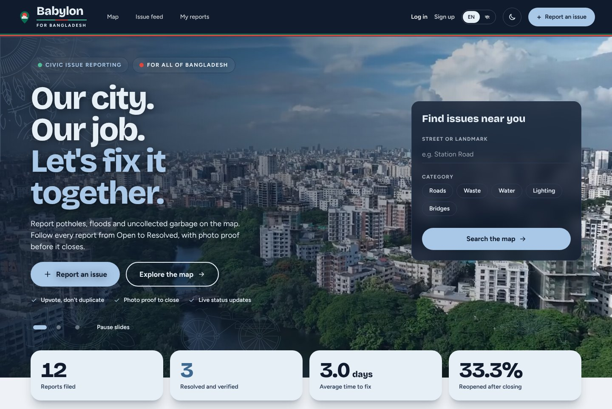
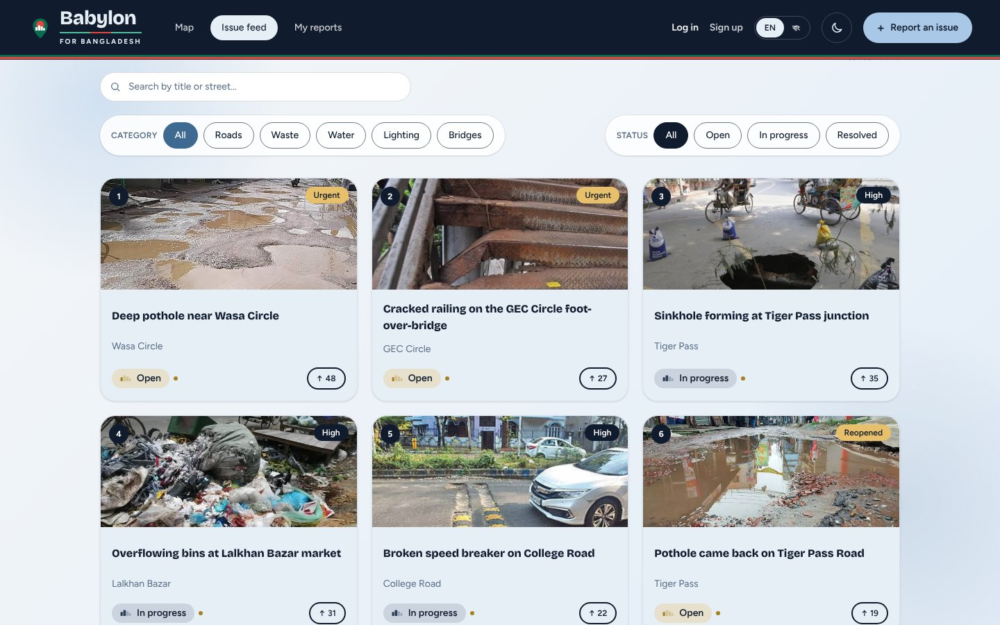
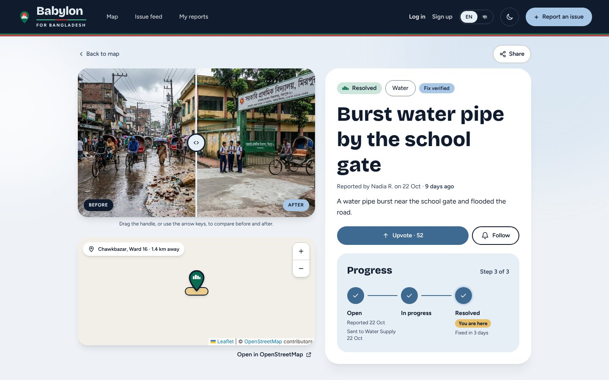
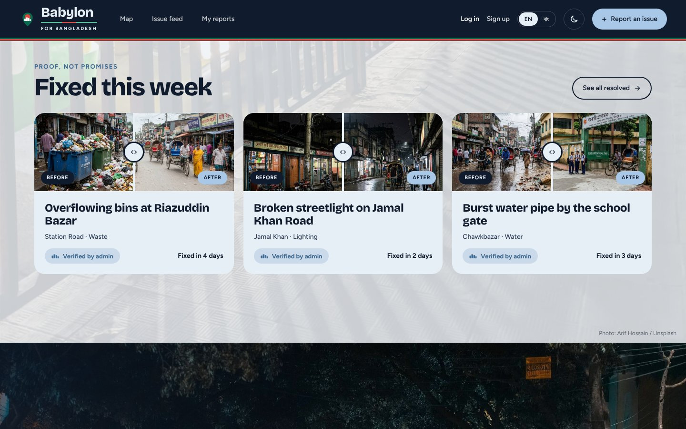
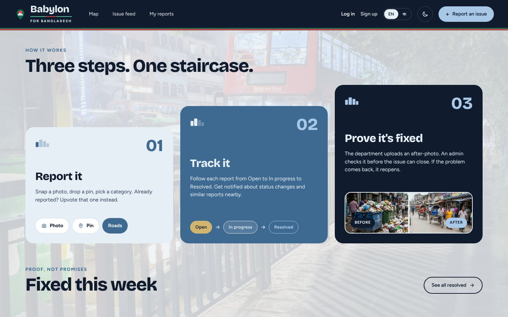
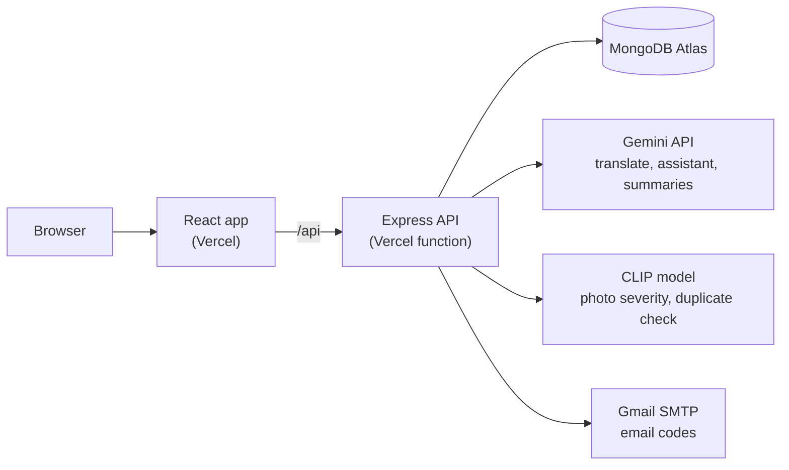

<div align="center">

# Babylon

**Report. Track. Resolve.**

A civic issue reporting platform for Bangladesh. Citizens pin a problem on the map, the right city department fixes it, and an admin checks the photo proof before the issue is closed.

[Live demo](https://babylon-frontend.vercel.app) &nbsp;|&nbsp; [Screenshots](#screenshots) &nbsp;|&nbsp; [Try it](#try-it) &nbsp;|&nbsp; [Run it locally](#run-it-locally) &nbsp;|&nbsp; [Docs](docs/)


<br>



</div>

## What it does

| Citizens | Department staff | Admins |
| -------- | ---------------- | ------ |
| Report a pothole, flood or overflowing bin with a photo and a map pin. If someone already reported it, upvote that report instead. Follow it from Open to In progress to Resolved, and reopen it if the problem comes back. | See the issues assigned to their department, move them forward, and upload an after-photo when the work is done. A weekly summary of their work is written for them. | Check every fix against its photo before the issue can close, handle reopened issues, review identity checks, and watch how each department is doing on the accountability page. |

## Screenshots

<table>
  <tr>
    <td width="50%">
      
      <br><sub><b>Issue feed.</b> Search and filter by category and status. Ranked by priority, then votes.</sub>
    </td>
    <td width="50%">
      
      <br><sub><b>Issue page.</b> Before and after slider, upvote, follow and a three-step progress tracker.</sub>
    </td>
  </tr>
  <tr>
    <td width="50%">
      
      <br><sub><b>Fixed this week.</b> Only fixes an admin has verified show up here.</sub>
    </td>
    <td width="50%">
      
      <br><sub><b>How it works.</b> Report it, track it, prove it is fixed.</sub>
    </td>
  </tr>
</table>

## Highlights

- **Fixes are proven, not promised.** A department uploads an after-photo, an admin approves it, and only then does the issue close. The before and after photos sit side by side on the issue page and on Home.
- **One ranking rule everywhere.** Issues are ordered by priority, then by votes, then by newest, so the map, the feed and Home always agree.
- **Photo severity.** CLIP scores each report photo and sets its priority to medium, high or urgent. If the model is off or fails, the report is still created as medium.
- **Duplicate check.** Before filing, a citizen sees unresolved reports in their division with photos that look alike, and can upvote one instead of adding another.
- **AI helpers (Gemini).** A report assistant, a short-summary draft, a helper chat, a weekly department summary and Bangla and English translation. They are called from the server only. Without a key they answer 503 and the rest of the app keeps working.
- **Accountability.** Average time to fix and reopen rate come from one shared stats service that Home and the admin page both read, so the two never disagree.
- **Bangla and English, light and dark.** The whole interface switches language and theme.
- **Careful with accounts.** JWT sign-in, bcrypt password hashes, Zod checks on every request, rate limits, and staff sign-up gated by an access code, an Employee ID roster, and phone and email checks.

## Architecture



The API has one folder per panel (public, auth, citizen, department, admin). A request goes `routes -> controller -> service -> model`, and answers always look like `{ success, message, data }`. More in [docs/ARCHITECTURE.md](docs/ARCHITECTURE.md).

## Tech stack

| Layer | Tools |
| ----- | ----- |
| Frontend | React 19, react-router-dom 7, Vite 8, Tailwind CSS 4, Leaflet with react-leaflet, Recharts |
| Backend | Node.js 20.19+, Express 5, Mongoose 9, JWT, bcrypt, Zod, Multer, Nodemailer |
| Database | MongoDB Atlas |
| AI | Google Gemini for text helpers, CLIP through `@huggingface/transformers` for photo severity and duplicates |
| Hosting | Vercel, as two projects (frontend and backend) |
| Quality | Node's built-in test runner, ESLint 10, Postman collections |

## Try it

Open the **[live demo](https://babylon-frontend.vercel.app)** and sign in with one of these demo accounts. Every account uses the password `password123`.

| Role | Email | Sign in at |
| ---- | ----- | ---------- |
| Citizen | `citizen@babylon.test` | `/login` |
| Department | `roads@babylon.test` | `/staff/login` |
| Admin | `admin@babylon.test` | `/staff/login` |

The sign-in pages hide these accounts on the live site, which is why they are listed here. They are demo data, not real credentials. The API health check is at [`/api/health`](https://babylon-backend.vercel.app/api/health).

## Run it locally

You need Node.js 20.19 or newer and a MongoDB database (a free Atlas M0 cluster works).

```bash
# 1. Backend
cd backend
npm install
cp .env.example .env      # fill in MONGODB_URI and JWT_SECRET
npm run seed              # demo data, safe to run again
npm run dev               # http://localhost:5000

# 2. Frontend, in a second terminal
cd frontend
npm install
npm run dev               # http://localhost:5173
```

In development Vite forwards `/api` to the backend, so there is nothing else to configure. All scripts, every environment variable, real email codes and the Postman files are covered in the **[setup guide](docs/SETUP.md)**. Deployment is in [docs/DEPLOYMENT.md](docs/DEPLOYMENT.md).

## Repository layout

```
babylon/
├── backend/    Express API: src/ (one folder per panel), scripts/ (seed), postman/, tests/
├── frontend/   React app: src/ (pages, components, services), public/, tests/
└── docs/       setup, deployment and architecture guides, and the screenshots above
```

## Testing

Run `npm test` in `backend/` or `frontend/`. The tests use in-memory fakes, so they need no database, Gemini key or CLIP model. The Postman collections in `backend/postman/` are sent by hand, and the testing logs next to them record the results.

## Team

Babylon was built by four students. Each person built the frontend pages and the backend panel for their part of the app.

<table>
  <tr>
    <td align="center" width="25%"><a href="https://github.com/f-akhter-t"><br><sub><b>Farhana</b></sub></a></td>
    <td align="center" width="25%"><a href="https://github.com/RiktikaTalukder"><br><sub><b>Riktika</b></sub></a></td>
    <td align="center" width="25%"><a href="https://github.com/meherimonir"><br><sub><b>Meheri</b></sub></a></td>
    <td align="center" width="25%"><a href="https://github.com/joyti39"><br><sub><b>Joyti</b></sub></a></td>
  </tr>
</table>

## Credits

Map data from OpenStreetMap contributors. The hero videos come from Pexels, with credits in [`frontend/public/videos/CREDITS.md`](frontend/public/videos/CREDITS.md).
