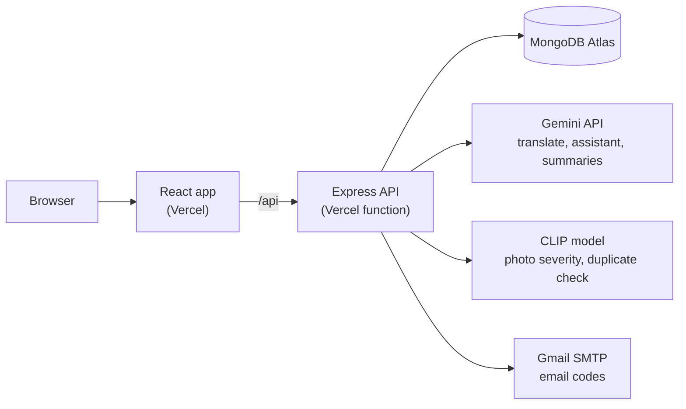

# Architecture

Babylon is a React single-page app talking to an Express API, which stores everything in MongoDB Atlas. The AI helpers (Gemini, CLIP) and the email codes are called from the server only, so no key ever reaches the browser.



## API panels

Every panel has its own folder in `backend/src/` with routes, controller and service. They are mounted in `backend/src/routes.js`.

| Mount | Who uses it | What it covers |
| ----- | ----------- | -------------- |
| `/api` (public) | Anyone | Home data (`/home/*`) and the issue list and detail (`/issues`). |
| `/api/auth` | Everyone | Sign up, log in, `me`, password reset, and staff onboarding (codes, Employee ID, phone and email checks). |
| `/api/citizen` | Citizens | Reports (create, edit, delete), votes, reopen, alerts, profile and identity check, report assistant, duplicate check, helper chat. |
| `/api/department` | Department staff | Their issue queue, status changes, submitting an after-photo, summaries and the weekly summary. |
| `/api/admin` | Admins | Verification queue, reopened queue, identity review, accountability figures, alerts. |
| `/api/translate` | Any signed-in user | Bangla and English translation of issue text. |

## Folder layout

```
babylon/
├── backend/
│   ├── src/
│   │   ├── app.js, server.js, routes.js   the app, the entry point and the route mounts
│   │   ├── admin/ auth/ citizen/ department/ public/   one folder per panel: routes, controller, service
│   │   ├── shared/service/                code every panel uses: issues, alerts, stats, CLIP, Gemini, email and phone codes
│   │   ├── models/                        Mongoose models (only services import them)
│   │   ├── middlewares/ config/ constants/ utils/
│   ├── scripts/        seed, token and CLIP check scripts
│   ├── postman/        collections to send by hand
│   └── tests/          backend tests (fakes only)
└── frontend/
    ├── public/         favicon, images and videos
    └── src/
        ├── App.jsx     the routes
        ├── index.css   Tailwind theme tokens and global styles
        ├── components/
        │   ├── layout/ Navbar, Footer, Logo and the staff panel layout
        │   └── ui/     shared pieces such as Button, StatusPill and LoadError
        ├── hooks/      shared React hooks
        ├── pages/      one folder per page (Home, Map, Feed, Report, Profile, staff panels…)
        ├── services/   http.js and the API files; accounts and the session (auth.js)
        └── utils/      small helpers for dates, maps, images and form rules
```

A backend request goes `routes -> controller -> service -> model`. Only services import models, and a panel imports only its own files, `models/`, `shared/service/`, `utils/` and `constants/`. Answers look like `{ success, message, data }`, and errors like `{ success: false, code, message, field? }`.
